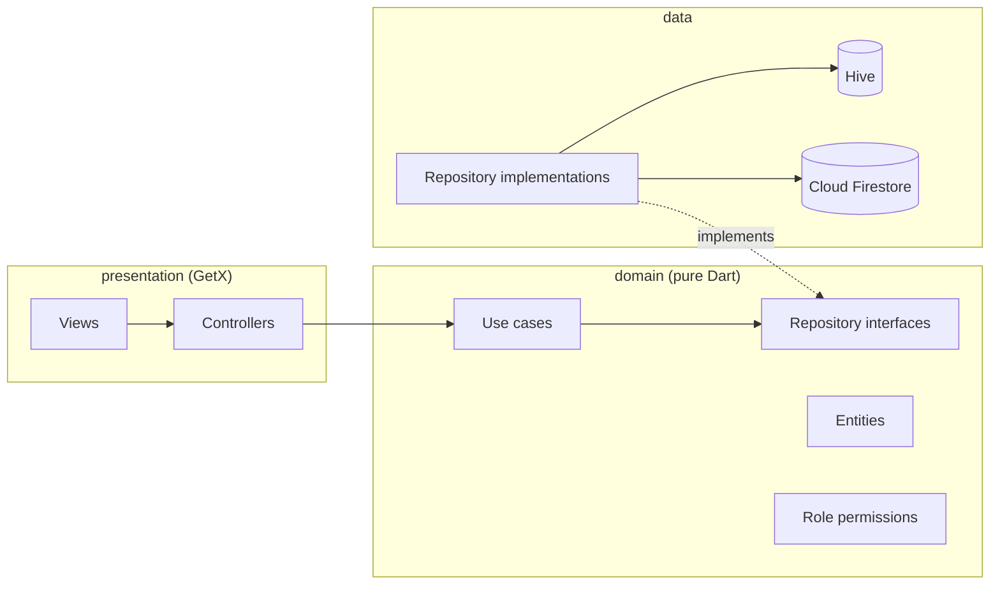

# Cashiere POS: Flutter point of sale with Clean Architecture

[](https://github.com/Zyadashraf5/flutter-pos-clean-architecture/actions/workflows/ci.yml)


A point-of-sale and back-office app for phone and electronics shops. Staff sell devices by serial number, track stock and supplier debt, and see cash, credit and tax totals, in Arabic or English. Built with Flutter, GetX, Hive for local storage and Cloud Firestore for sync.

## The problem it solves

Small phone shops usually juggle a notebook for sales, a spreadsheet for stock and WhatsApp for supplier balances. Each used device is unique (serials, battery health, condition), so a generic quantity-based POS does not fit. Cashiere keeps one record per device, ties every sale to who made it, and keeps the shop's money position (cash, credit, taxes, money owed to suppliers) up to date as sales and purchases happen.

## Features

| Area | What it does |
|---|---|
| Sales | Create orders with per-item tax; pay by cash, credit, bank transfer or e-wallet. Totals are recalculated from the items in the domain layer, not trusted from the UI. |
| Device inventory | One record per device: two serial numbers, condition (new/used), battery health, storage, colour, receiving price, supplier. Devices are marked sold with their selling price. |
| Products & categories | Barcode-based products, categories and stock levels. |
| Barcode / QR | Scan barcodes with the camera when selling or adding products (`mobile_scanner`), and show a QR code for each product (`qr_flutter`). |
| Suppliers & purchases | Cash or credit purchases; stock is increased with a weighted-average purchase price; unpaid amounts become supplier debt; payments reduce it. |
| Financial summary | Cash, credit, total sales, taxes collected and supplier debt, with charts (`fl_chart`). |
| Staff & roles | Admin, manager, cashier, inventory staff and accountant roles. Each screen route is mapped to a permission. |
| Arabic / English | Full RTL layout, language saved per device. |
| Offline-first | Hive local storage; Firestore is read first and the app falls back to local data when it is unavailable. |

## Architecture



```
lib/
├── core/           DI (GetX bindings), routes, theme, localization, utils (bcrypt hashing, logger)
├── domain/         entities, repository interfaces, use cases, role/permission rules
├── data/           Firestore + Hive data sources, models, repository implementations
└── presentation/   one module per screen: binding + controller + view
```

The domain layer has no Flutter UI, Firestore or Hive imports, so business rules are tested with in-memory fakes (see `test/support/fakes.dart`).

### Design decisions

- **Save first, then side effects.** `CreateOrder` and `CreatePurchase` persist the record before touching inventory, stock or the financial summary, so a failed save can never leave revenue or stock changes without a matching order or purchase. Follow-up steps are isolated and logged so one failure does not crash the app (the Windows Firestore SDK is sensitive to unhandled errors).
- **Totals are computed in the domain.** The order total, subtotal and tax are rebuilt from the line items; values sent by the UI are ignored.
- **Passwords are hashed with bcrypt** (`lib/core/utils/password_hash.dart`) before an employee record is stored.
- **Firebase config is injected at build time** with `--dart-define-from-file`, so no project identifiers live in the repository.

## Tech stack

Flutter · Dart 3.9 · GetX (state, routing, DI) · Hive · Cloud Firestore · bcrypt · fl_chart · mobile_scanner · qr_flutter · intl · GitHub Actions

## Getting started

Requirements: Flutter 3.35 or newer (stable channel) and a Firebase project with Cloud Firestore enabled.

```bash
git clone https://github.com/Zyadashraf5/flutter-pos-clean-architecture.git
cd flutter-pos-clean-architecture
flutter pub get
```

### Firebase setup

1. Create a Firebase project and register the platforms you need (Android, iOS, Web; Windows uses the Web registration).
2. Copy `firebase.env.example.json` to `firebase.env.json` (already in `.gitignore`) and fill in the values from your Firebase console.
3. Android only: place your own `google-services.json` in `android/app/` (ignored by git). The Google Services Gradle plugin is applied only when that file exists.
4. Deploy the Firestore rules if you want them enforced: `firebase deploy --only firestore:rules` (see *Known limitations*).

### Run

```bash
flutter run -d windows --dart-define-from-file=firebase.env.json
# or: -d android, -d chrome
```

On first launch an admin can seed demo categories, products and orders from the admin screen. The seed data is generated (for example "Product 1 (Category)"), not real customer data.

## Tests and CI

```bash
flutter test
```

| Test file | What it covers |
|---|---|
| `test/domain/create_order_test.dart` | Validation (empty orders, quantities, negative prices or tax), total recalculation, save-before-side-effects ordering, cash vs credit, devices marked as sold |
| `test/domain/purchases_and_suppliers_test.dart` | Purchase persistence order, stock increases with purchase price, credit debt, supplier payments |
| `test/domain/auth_and_permissions_test.dart` | bcrypt hashing, login rules (email normalisation, generic errors, disabled accounts), role permission matrix |
| `test/domain/route_access_test.dart` | Every screen route is mapped to a permission for every role |
| `test/widget_test.dart` | App theme builds |

GitHub Actions runs `flutter analyze` and `flutter test` on every push and pull request (`.github/workflows/ci.yml`).

## Known limitations

Written down on purpose, as the next steps for this codebase:

- **Authentication runs on the client.** Staff log in against the `employees` collection and the bcrypt hash is verified on the device; there is no Firebase Auth session. Permissions are enforced in the app, not on the server. The included `firestore.rules` assume Firebase Auth, so they do not match the current login flow. Moving login to Firebase Auth (with custom claims for roles) is the planned fix.
- **Two role models exist** (`EmployeeRole` for staff records and `UserRole` for the session). They are mapped in one place (`AuthRepositoryImpl`) and should be merged.
- **Multi-step writes are not transactional.** The order is saved first and the inventory and financial updates follow; if a follow-up step fails it is logged rather than retried.
- Android and Windows are the main targets. The other Flutter platform folders are scaffolding and have not been tested.

## Author

**Zyad Ashraf**, Flutter developer · [LinkedIn](https://www.linkedin.com/in/zyad-ashraf-flutter) · [Upwork](https://www.upwork.com/freelancers/~01f783ee63786311ea)
